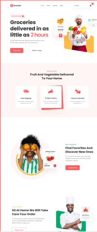

# Grover — Fresh Groceries Delivered in 2 Hours (21-Amaliy Ish)

Figma dizaynining yuqori aniqlikdagi (Pixel-Perfect) to'liq veb-sahifasi: **Grover - Grocery Delivery Landing Page**.

[-F24E1E?logo=figma&logoColor=white)](https://www.figma.com/file/vQaUY7pL5oncokMwk8m1bj/Landing-Page-Kits-V1-(Community)?type=design&node-id=1%3A161&mode=design&t=HLPvO9qzMksXGb1T-1)
[](https://developer.mozilla.org/en-US/docs/Web/HTML)
[](https://developer.mozilla.org/en-US/docs/Web/CSS)
[](https://developer.mozilla.org/en-US/docs/Web/JavaScript)
[](https://greensock.com/)
[](https://vercel.com/)

---

## 📷 Figma Dizayn Ko'rinishi



---

## 🚀 Loyiha haqida

Ushbu loyiha Figma platformasidagi **Landing Page Kits V1 (Community)** andozasining **Grover Grocery Store** sahifasi (node-id: `1:161`) asosida to'liq va mukammal ishlab chiqilgan. Loyiha yangi uzilgan meva, sabzavot va oziq-ovqat mahsulotlarini 2 soat ichida eshikkacha yetkazib beruvchi onlayn servisning zamonaviy va interaktiv landing sahifasini ifodalaydi.

---

## 🌟 Asosiy Bo'limlar

1. **Header & Sticky Glassmorphism Navbar**:
   - `Grover` brendi logotipi (`grover-logo.svg`).
   - Dinamik silliq navigatsiya havolalari (`Home`, `Menu`, `Service`, `Shop`) va scrollspy faol nuqta indikatori.
   - Jonli qidiruv tizimi (input orqali mahsulotlarni qidirish va savatchaga qo'shish).
   - Interaktiv Savatcha tugmasi (dinamik hisoblagich va ochiluvchi Cart Drawer).
   - Mobil qurilmalar uchun SVG animatsiyali Hamburger menyusi va suriluvchi Drawer.

2. **Hero Bo'limi (`#Homepage`)**:
   - `More than Faster` badjisi va qulupnay belgisi.
   - Asosiy chaqiruv sarlavhasi: *"Groceries delivered in as little as 2 hours"*.
   - `Order Now` va `Order Process` (3 bosqichli yetkazib berish jarayoni modali) tugmalari.
   - 3D interaktiv vizual kompozitsiya: Oshpaz (`Group 2.png`), suzuvchi apelsin kartasi (`orange-card.png`) va yetkazib berish vaqti kartasi (`alarm-card.png`).

3. **Services Bo'limi (`#our-services`)**:
   - *"What we Serve"* / *"Fruit And Vegetable Delivered To Your Home"*.
   - 3 ta 3D Tilt effektli interaktiv xizmat kartochkalari:
     - 🚚 **Free Shipping** — Barcha buyurtmalar uchun bepul yetkazib berish.
     - 🔄 **15 Days Returns** — Sifatsiz mahsulotlar uchun 15 kunlik kafolatli qaytarish.
     - 🔒 **Secure Checkout** — 100% xavfsiz va shifrlangan to'lov tizimi.

4. **Why Choose Us Bo'limi (`#whyUs`)**:
   - Chap tomonda: Qiz surati (`orange-girl.png`) va suzuvchi qulupnay kartasi (`strwaberry-card.png`).
   - O'ng tomonda: Afzalliklar ta'rifi va `Explore Now` tezkor buyurtma tugmasi.

5. **Home Delivery Bo'limi (`#delivery`)**:
   - Chap tomonda: Uyga yetkazish haqida ma'lumot va `Explore Now` tugmasi.
   - O'ng tomonda: Skuterli kuryer (`delivery-man.png`), suzuvchi "30 min yetkazish" kartasi (`delivey-card.png`) va zamonaviy yarim-aylana fon grafikasi (`semicircle.png`).

6. **Mobile App Bo'limi (`#application`)**:
   - Grover mobil ilovasining smartfon maketi (`mobile-mockup.png`).
   - Ilovaning imkoniyatlari ta'rifi.
   - **App Store** va **Google Play** yuklab olish interaktiv tugmalari.

7. **Footer & Copyright**:
   - Kompaniya, xizmatlar va ijtimoiy tarmoqlar havolalari.
   - Elektron pochtaga obuna bo'lish (Newsletter) formasi va muvaffaqiyat toasti.
   - Mualliflik huquqi va maxfiylik siyosati havolalari.

---

## ⚡ Interaktiv Imkoniyatlar

- 🛒 **To'liq Ishlovchi Savatcha (Shopping Cart Drawer)**:
  - Mahsulotlar sonini oshirish/kamaytirish (+ / -)
  - Mahsulotni savatchadan o'chirish
  - Jami summani avtomatik hisoblash
  - Sahifadagi suzuvchi kartochkalarni bosish orqali yangi mahsulot qo'shish
- 🔍 **Jonli Qidiruv (Live Search & Dropdown)**:
  - Inputga yozganda mahsulotlar ro'yxatini real vaqtda saralash
  - Natijani tanlaganda to'g'ridan-to'g'ri savatchaga joylash
- 📋 **Order Process Modal**:
  - Jarayon qanday ishlashini tushuntiruvchi 3 bosqichli chiroyli modal
- 📦 **Express Order Modal**:
  - Buyurtmani tezda rasmiylashtirish formasi (ism, telefon, manzil)
- 🔔 **Toast Bildirishnomalari (Toast Engine)**:
  - Savatchaga qo'shish, o'chirish, obuna va buyurtma tasdiqlarida animatsiyali bildirishnomalar
- 🔝 **Back to Top Tugmasi**:
  - Sahifa pastga surilganda paydo bo'luvchi va bir bosishda yuqoriga qaytaruvchi suzuvchi tugma
- 📱 **Mobil Moslashuvchanlik (Fully Responsive)**:
  - Barcha smartfonlar, planshetlar va noutbuklar uchun sinovdan o'tgan qulay interfeys

---

## 📂 Loyiha Fayl Tuzilishi

```text
amaliy 21/
├── assets/
│   └── images/
│       ├── alarm-card.png
│       ├── apple-icon.svg
│       ├── cart-image.svg
│       ├── delivery-man.png
│       ├── delivery.svg
│       ├── delivey-card.png
│       ├── favicon.png
│       ├── figma_preview.png
│       ├── Group 2.png
│       ├── grover-logo.svg
│       ├── header-play-btn.png
│       ├── header-play-btn.svg
│       ├── mobile-mockup.png
│       ├── orange-card.png
│       ├── orange-girl.png
│       ├── playstore-logo.svg
│       ├── return.svg
│       ├── search icon.svg
│       ├── secure.svg
│       ├── semicircle.png
│       ├── strawberry.png
│       └── strwaberry-card.png
├── css/
│   ├── reset.css
│   └── style.css
├── js/
│   └── main.js
├── figma_preview.png
├── index.html
├── vercel.json
└── README.md
```

---

## 🛠 Ishlatilgan Texnologiyalar

- **HTML5**: Semantik teglash (`<header>`, `<nav>`, `<main>`, `<section>`, `<article>`, `<footer>`).
- **CSS3**: BEM metodologiyasi, CSS maxsus o'zgaruvchilari (Custom Properties), Flexbox, CSS Grid, media queries.
- **JavaScript (ES6+)**: DOM manipulyatsiyasi, holat boshqaruvi (Cart State), hodisalar nazorati.
- **GSAP & ScrollTrigger**: Sahifa elementlarining silliq va professional chiqish animatsiyalari.
- **VanillaTilt.js**: Kartochkalar va suzuvchi elementlar uchun 3D paralaks effekti.
- **FontAwesome 6**: Vektorli zamonaviy piktogrammalar.
- **Google Fonts (Poppins)**: Tipografiya va shriftlar tizimi.

---

## 💻 Loyihani Ishga Tushirish

1. Ushbu omborni klonlang yoki yuklab oling:
   ```bash
   git clone https://github.com/soxibs48-eng/amaliy21.git
   cd amaliy21
   ```

2. Sahifani brauzerda oching:
   - `index.html` faylini istalgan brauzerda (Chrome, Firefox, Edge, Safari) oching.
   - Yoki VS Code dasturida **Live Server** kengaytmasidan foydalaning.

---

## 🌐 Deploy (Vercel)

Loyiha Vercel platformasiga deploy qilish uchun to'liq sozlangan:
```bash
npx vercel
```

---

## 👤 Muallif

- **Muallif**: [soxibs48-eng](https://github.com/soxibs48-eng)
- **Topshiriq**: 21-Amaliy Ish (Figma Landing Page Implementation)
